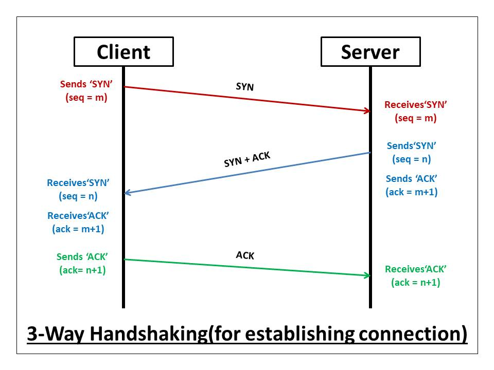
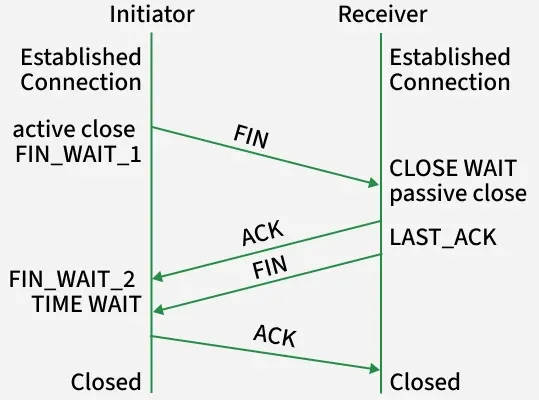

### Key concepts of TCP
Before we dive into nmap itself, we should look at some basic TCP/IP networking and see why nmap shows the ports scanned as `open`, `closed` or `filtered`.  
When trying to connect to an open service hosted on a machine using TCP, we typically send a SYN packet, the server responds SYN+ACK, then we send ACK and the connection is opened. To close one such connection, we send a FIN, the server responds FIN+ACK, we send ACK and connection closed. If errors arise, a RST packet is sent, signaling that the sender of this packet will stop listening on that socket.

  

source: [velog](https://velog.velcdn.com/images/xx0hn/post/b8c269b8-760a-4d5a-9b87-ba0dbe9d0c62/what-is-a-tcp-3-way-handshake-process-three-way-handshaking-establishing-connection-6a724e77ba96e241.jpeg)

  

source: [geeksforgeeks.org](https://media.geeksforgeeks.org/wp-content/uploads/20251106163448590456/initiator.webp)  

| Response    | State                                            |
| ----------- | ------------------------------------------------ |
| SYN+ACK     | Port is `open` and accepts connections. Good!    |
| RST         | Port is `closed`                                 |
| No response | Port is `filtered`, likely blocked by a firewall |
### SYN scan
When trying to identify all the exposed services, first thing to do is to try and send a SYN packet to all the ports available (65 535) and wait for a response.  
To be stealthier and faster, nmap never actually establishes any connection. In fact, we can determine the state of a port by sending just a SYN and wait for the response.  
This is called a `SYN scan`, and it's the default scanning method of nmap.  

This is how you start a SYN scan:
```sh
nmap -sS 192.168.1.0/24
```

Differently from what we did with the `-sn` scan, it makes sense here to specify a single target rather than the whole subnet:
```sh
nmap -sS 192.168.1.100
```

We can also specify a set of targets, either through inputting them one after the other, or by creating an input file with every IP separated by a newline:
```sh
nmap -sS -iL <filename>
```

### Making sense of the output
```
Starting Nmap 7.94SVN ( https://nmap.org ) at 2026-09-14 20:09 CEST
Nmap scan report for target_machine (192.168.1.100)
Host is up (0.000017s latency).
Not shown: 997 closed tcp ports (reset)
PORT    STATE SERVICE
80/tcp  open  http
111/tcp open  rpcbind
631/tcp open  ipp

Nmap done: 1 IP address (1 host up) scanned in 0.19 seconds
```

>[!Note]
>If a scan takes long, you can verify its status by pressing spacebar in the terminal

Sooooo....  
First lines are metadata for the scan itself, like the version of nmap, when it started, who the scan targeted. We can then see that nmap hides all the closed ports, displaying the reason it believes those ports are closed in parenthesis.  
Then we see the list of all the ports that nmap believes open and the service associated with them. When talking about standard ports, the port number usually identifies the service, but it's not enforced by anyone. In this type of scan, nmap usually shows the service generally associated with that port, and anyway it doesn't display anything more about it. To get such information, you have to run [service detection] ().

### Did we scan 65 535 ports in such a small amount of time?
Well, no.  
Nmap has a list of the top 1000 ports, and it scans those by default. But we have options:

| Description         | Flag          |
| ------------------- | ------------- |
| Scans top N ports   | --top-ports=N |
| Scans top 100 ports | -F            |
| Scan custom ports   | -p\<number\>  |
| Scan all 65 535     | -p-           |

Don't be fooled by the wording here: top N ports does **not** mean ports 0-N, but the most commonly open N ports instead. To do that, you have to specify a range in the `-p` parameter, like this: `-p5-1200`. Because lower and upper limits can be omitted, `-p-` will scan ports from 1 to 65535.

### You should almost always scan all the ports
Even though it's pretty time consuming. Non-standard ports are usually where custom, developing or debugging services run. As an example, a developer might have forgotten about a server open on port 8080 exposing an internal directory, or it might have much less strict security policies. What you can do is run a standard nmap scan, and then run the full one in the background. You will learn about [optimizing your scans]() in chapter [**TODO**]()

### Getting more details
We have the opportunity to display additional information about the scan. In fact, nmap lets us trim the verbosity of the tool through some flags. The ones I use the most are:

| Description                                    | Flag               |
| ---------------------------------------------- | ------------------ |
| Verbose. Displays additional/debug information | `-v/vvvv`          |
| Displays the reason it believes so             | `--reason`         |
| Packet trace                                   | `--packet-trace`   |
| Shows percentage of current scan               | `--stats-every=5s` |

For a simple `SYN scan`, we're all set.
**Next**: [[5 - Optimization]]